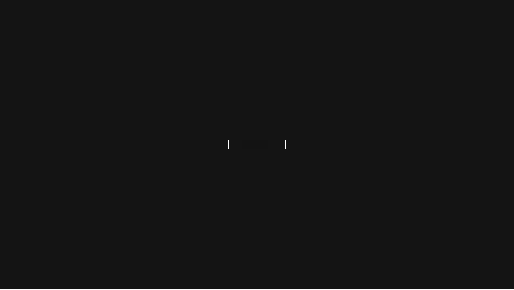

## Tsundoku-white Dotfiles 

## Wallpaper


## Lockscreen


## how to use?
```bash
chmod +x ~/dotfiles/install.sh
~/dotfiles/install.sh
```
then your done pritty much.

for packages look at
- [AUR PACHAGES](./pkglist-aur.txt) 
- [FLATPAK PACHAGES](./pkglist-flatpak.txt) 
- [REPO PACHAGES](./pkglist-repo.txt)

## Dependanciece
gt6 and arch linux

